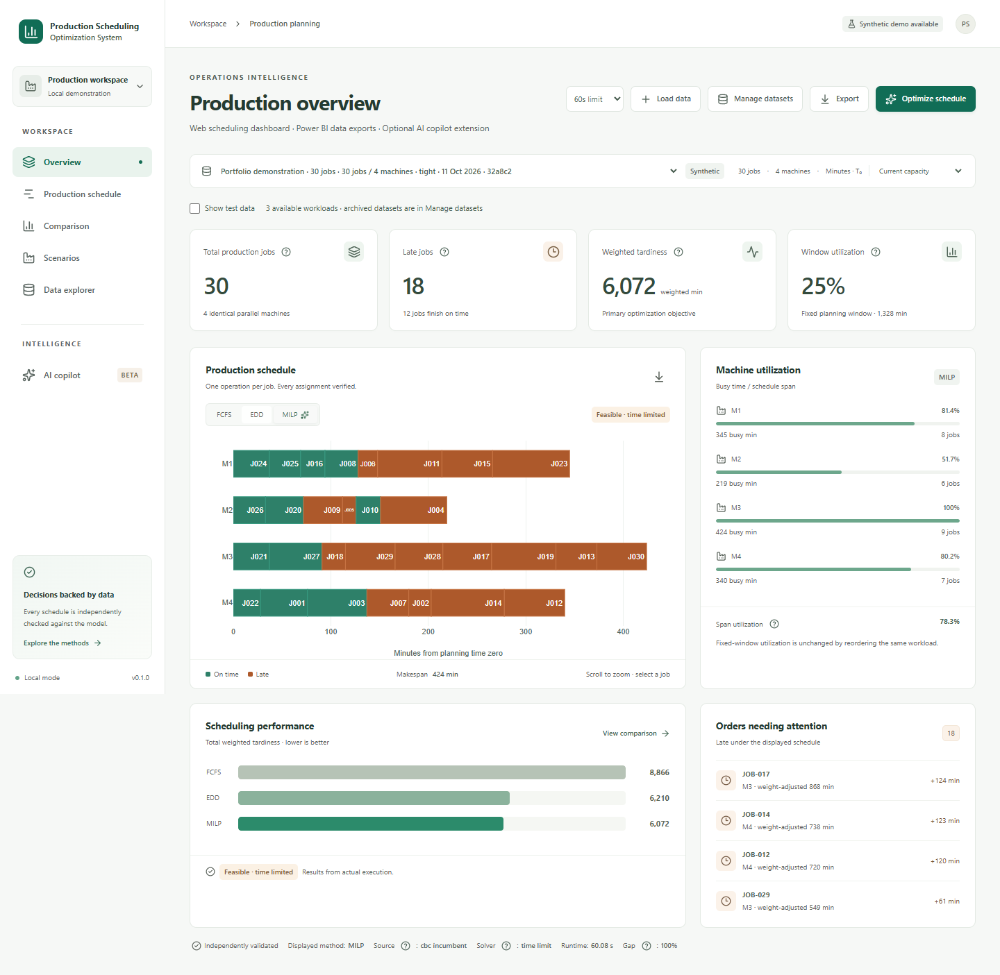

# Production Scheduling Optimization System

**Web dashboard · Power BI data exports · Optional AI copilot extension**

A local, single-user production planner with independently validated schedules, transparent
solver status, and an optional evidence-grounded AI copilot. The scheduling engine works without
an API key. Synthetic examples demonstrate industrial engineering methods; no company data or
production results are claimed.

This standalone project contains the scheduling backend, Web dashboard, dependency locks, and checks.



## What it does

- Generate reproducible relaxed, tight, or staggered workloads, or preview and confirm a CSV import.
- Search the workload library, hide test data by default, and archive/restore workloads without
  deleting jobs or results. Dataset, scenario and method selections persist on this browser.
- Calculate deterministic FCFS and EDD baselines automatically; explicitly queue CBC optimization.
- Inspect machine lanes, hover or select jobs, zoom, and read an accessible schedule table.
- Compare weighted tardiness, late jobs, makespan, two utilization measures, and solver provenance.
- Create the same workload with exactly one extra identical machine, preserving baseline runs.
- Download a coherent Power BI ZIP for the displayed run, three-method comparison, or
  baseline-plus-one-machine comparison, including four CSV tables, exact metadata, M and DAX source.
- Open metric help for formulas, examples, actual denominators, and honest solver status; read
  calculated comparison summaries explaining tardiness, late-job and makespan tradeoffs.
- Optionally ask a single agent to read facts or queue bounded calculations.

Base inputs support 1–50 jobs and 1–5 identical machines; the derived scenario can have six.
All times are integer minutes from time zero. Due times are soft targets except for selected hard-deadline commitments. The objective is total
weighted tardiness. A time-limited feasible schedule is never labelled a proven optimum.

## Commitments, What-if and explanation

Use **Plan commitments / What-if** to preview and confirm orders that must meet their existing
due times, optionally adding one identical machine. The Scenarios page compares saved inputs
and solver outcomes; **Explain** shows explicit run comparisons and order-level contributions.
These workflows work without an AI key. Configured Copilot tools can propose rules and retrieve
calculated evidence; the UI requires confirmation before saving a proposed scenario.
See [the planning workflow](docs/opspilot/ai-planning.md) for status semantics and current scope.

## Windows setup

Python 3.13 and Node.js 24 are required. Run these commands from the repository root in PowerShell:

```powershell
py -3.13 -m pip install uv==0.13.0
py -3.13 -m uv sync --project backend --locked --extra dev
Push-Location frontend
npm ci
npm run build
Pop-Location
backend/.venv/Scripts/python.exe -m uvicorn opspilot.api.main:app --host 127.0.0.1 --port 8000
```

Open [the scheduling system](http://127.0.0.1:8000) and [API documentation](http://127.0.0.1:8000/docs).
Startup applies pending Alembic migrations to `runtime/opspilot.db`, including dataset visibility
metadata. Restart an already running backend after a code update. No `.env` is required.
Keep one backend process; do not use multiple Uvicorn workers with the in-process execution queue.

CBC is installed by the locked `pulp[cbc]` extra. On this development machine, Windows Smart App
Control blocked DLLs in that packaged distribution. The official standalone CBC release worked
without changing security settings. If the solver health check fails for the same reason:

```powershell
backend/.venv/Scripts/python.exe scripts/opspilot_install_cbc.py
```

The helper downloads official CBC 2.10.13, checks archive paths, saves source and SHA-256 provenance
under ignored `runtime/solvers/`, and is safe to rerun. Alternatively set `CBC_PATH` to an available
CBC executable. Solver errors leave baseline scheduling available. The standalone Windows build
is serial; its unsupported `threads` option is harmless. The packaged Linux build receives one
thread. Do not disable Windows security controls to run this project.

For frontend development, leave the backend running and run `npm run dev` inside `frontend/`;
Vite uses port 5174 and proxies `/api` to port 8000. The built app and API can share port 8000.

## Linux and Docker

```sh
python3.13 -m pip install uv==0.13.0
python3.13 -m uv sync --project backend --locked --extra dev
npm --prefix frontend ci
npm --prefix frontend run build
backend/.venv/bin/python -m uvicorn opspilot.api.main:app --host 127.0.0.1 --port 8000
# Alternative, on a machine with Docker already installed:
docker compose up --build
```

Compose binds localhost:8000 and persists SQLite in the `opspilot-data` volume. The multi-stage
image builds the React UI and serves it with FastAPI as a non-root user. Docker and Linux checks
are configured in `.github/workflows/opspilot.yml`. They were not executed locally because Docker
and a Linux distribution are unavailable here; successful CI execution is still a release gate.

## Optional AI

Chinese walkthrough: [自然语言排程快速上手](docs/opspilot/ai-quickstart-zh.md).

There are two distinct roles in this project:

| Role | Current implementation |
|---|---|
| Calculate schedules | FCFS, EDD and CBC/MILP, with independently validated results. No reinforcement learning or automatic retraining is implemented. |
| Help people state requirements and understand results | Optional language-model draft extraction, clarification, scenario proposals and evidence-grounded explanations. |

The language model does not replace the scheduling engine. The website currently accepts text;
you can use your operating system's voice typing to enter spoken requirements. A built-in
microphone and unrestricted conversational decision adviser are not implemented.

Choose **Describe workload** to create a new workload from a Chinese or English description.
Review and edit the extracted orders; missing critical fields require a follow-up. Confirm the
table and listed defaults before the system saves data or queues scheduling. See
[natural-language workload creation](docs/opspilot/natural-language-workloads.md).

The complete scheduling and reporting workflow works without AI. The optional copilot provides
a natural-language interface to existing business functions: read production KPIs, calculated
late orders and utilization; compare saved results; explicitly request optimization or the
additional-machine scenario; retrieve calculation status. The MILP solver creates schedules.
The agent selects facts and approved interpretations, and application code renders their values.

For example, ask "Which orders are late?", "Compare the scheduling methods", or "Simulate one
additional machine". Computations return pending handles and the Web UI polls for completion.
This extension can make multi-step lookup more convenient, but the same work is available through
ordinary controls. It is not a forecasting model or an autonomous planner. Local subscription
smoke checks verified a summary and confirmed-preview flow; broad model quality remains unassessed. See [the copilot capability guide](docs/opspilot/copilot.md).

Copy the relevant settings from `.env.example` to `.env` and explicitly set:

```dotenv
AI_ENABLED=true
AI_PROVIDER=openai_api
OPENAI_API_KEY=your-own-key
OPENAI_MODEL=your-chosen-model
OPENAI_AGENTS_DISABLE_TRACING=true
```

Restart the backend. There is no automatic model substitution. AI remains unavailable if any
required setting is missing. Paid Platform API requests have not been tested here.

For your own local ChatGPT/Codex subscription, use AI_PROVIDER=codex_subscription and
OPENAI_MODEL=gpt-6.1-sol after signing in with the official Codex CLI. No Platform API key is
required for that local mode. It explicitly uses low reasoning effort and subscription limits.
See [activation and scope](docs/opspilot/copilot.md#activation-and-verification); keep this mode
on your own computer, with the server bound to 127.0.0.1.
Review [AI_ASSISTANCE.md](AI_ASSISTANCE.md) before enabling or presenting AI functionality.

## Verify and reproduce

```powershell
backend/.venv/Scripts/python.exe -m pytest backend/tests -q
backend/.venv/Scripts/python.exe -m ruff check --config backend/pyproject.toml backend experiments scripts/opspilot_*.py
backend/.venv/Scripts/python.exe scripts/opspilot_openapi.py
Push-Location frontend
npm run generate:api
npm run typecheck
npm run lint
npm test
# Build first. Browser tests start/stop an isolated backend on 8011 with a fresh ignored database.
# Do not set OPSPILOT_BASE_URL to your personal database: tests create and archive synthetic data.
npm run test:e2e
Pop-Location
backend/.venv/Scripts/python.exe experiments/benchmark.py
# Optional: three independent benchmark processes, each with serial CBC
# backend/.venv/Scripts/python.exe experiments/run_parallel.py
backend/.venv/Scripts/python.exe experiments/analyze.py
```

CI installs Playwright Chromium; local tests use installed Chrome. The complete benchmark matrix
contains 90 base datasets, 270 method results, and five extra-machine scenarios. Results checkpoint
after each method and resume without recomputing existing records. This can take roughly an hour
at the 60-second CBC budget; duration depends on instance difficulty and hardware.

Use `scripts/opspilot_demo.py` against a running backend to generate the default 30-job demonstration,
save a receipt, and export the four BI tables. This creates new immutable datasets and runs.

## Evidence and design

- [Architecture and API](docs/opspilot/architecture.md)
- [Natural-language entry: examples, review and confirmation](docs/opspilot/natural-language-workloads.md)
- [Copilot capabilities, configuration and local subscription](docs/opspilot/copilot.md)
- [Hard deadlines, What-if and result explanations](docs/opspilot/ai-planning.md)
- [Natural-language implementation verification](docs/opspilot/natural-language-checks.json)
- [Mathematical model and metric definitions](docs/opspilot/mathematical-model.md)
- [Executed experiments and limitations](docs/opspilot/experiments.md)
- [Verification and owner review checkpoints](docs/opspilot/validation.md)
- [Initial release verification receipt](docs/opspilot/release-checks.json)
- [Current workflow-improvement verification receipt](docs/opspilot/product-checks.json)
- [Product naming and output-capability verification](docs/opspilot/rename-checks.json)
- [Demonstration walkthrough](docs/opspilot/demonstration.md)
- [Power BI relationships and measures](docs/opspilot/power-bi.md)
- [Dataset library, reporting and metric-help verification](docs/opspilot/product-improvements.md)
- [Manual first GitHub upload (Chinese)](docs/opspilot/github-manual.md)
- [Synthetic sample provenance](data/samples/README.md)

No shifts, setups, maintenance, precedence, heterogeneous machines, forecasting, ERP integration,
or multi-user authentication are modeled. Additional-machine outcomes quantify scheduling effects,
not purchasing ROI. Plotly is loaded lazily; its chart bundle remains relatively large.

The scheduling system source is MIT-licensed. Dependencies and any separately maintained portfolio assets retain
their own licenses. No public repository, deployment, or commercial service was created.

`scripts/opspilot_source_bundle.py` creates an allowlisted, standalone source ZIP under ignored
`runtime/distribution/` for manual GitHub practice. It excludes the portfolio, Git history, keys,
databases and installed dependencies; it does not initialize Git, commit, create a remote or push.

The current brand is Production Scheduling Optimization System. Internal compatibility paths
such as the Python package `opspilot`, existing SQLite file, documentation directory, scripts and
browser preference keys are retained so the rename preserves saved results and working setup.
