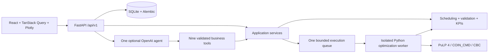

# Architecture

The core takes Pydantic `PlanningInput` and returns `ScheduleResult` without FastAPI, database
sessions, or an LLM. API services, experiments, and the agent tools reuse these functions.

## Execution and persistence

Scheduling returns HTTP 202 and UUID run handles. One executor runs work outside the API event
loop. At most ten runs wait behind one active run. Saturated requests return 429; data creation
reserves capacity before committing its immutable dataset. Solving never holds a database
transaction open. CBC runs in a separate Python process with controlled stdin arguments, an
elapsed-time budget, and a budget-plus-30-second parent watchdog. The watchdog kills the process
tree and retains a labelled heuristic fallback only when it satisfies all hard deadlines.
Without a feasible fallback it reports no validated result. A crashed worker produces an explicit failed run;
previous baselines remain usable. Graceful shutdown kills owned processes and marks unfinished
work interrupted. Startup marks abandoned queued/running records interrupted and preserves
completed results. Unfinished work is not automatically resumed.

SQLite connections enable foreign keys, WAL, and a 5,000 ms busy timeout. Results and schedule
items are committed together after independent validation and KPI recomputation. IDs are UUIDs;
audit times are UTC ISO 8601 strings. Dataset/job hashes use canonical SHA-256 JSON. Scenario
definitions share jobs and keep their own machine IDs and runs. One additional-machine scenario
per dataset is reused; invoking it again can queue new runs.

The initial Alembic migration is a frozen schema snapshot. Future schema changes require new
revisions; startup must not generate tables from whichever ORM version happens to be installed.

## Contracts

Execution state (`queued`, `running`, `completed`, `failed`, `interrupted`), solver termination
(`optimal`, `time_limit`, `gap_limit`, `infeasible`, `unbounded`, `error`, `not_run`), and schedule
source (`heuristic`, `cbc_incumbent`, `heuristic_fallback`) are separate fields. Completion means
the work finished. `proven_optimal` is true only for a solver-established optimum that validates.
Unknown bounds and gaps are null. Run configuration and algorithm version accompany every result.

The authoritative request and response contract is FastAPI OpenAPI, saved at
`backend/openapi.json`. `scripts/opspilot_openapi.py` refreshes it and `npm run generate:api`
generates TypeScript types consumed by the frontend. Validation, missing records, incompatible
contexts, and busy queues use 422, 404, 409, and 429 respectively.

Routes also provide read-only rule preview, confirmed immutable What-if creation, and per-run
explanations with optional explicit compatible baseline IDs. Rules change the input hash;
the same job hash and horizon are retained. Derived scenarios deduplicate by their full input hash.
Model version 2.0 records selected hard deadlines; legacy records remain unchanged.

Routes provide health, dataset list/detail/generation/CSV preview/import, scenario list/creation,
scenario runs, run detail, late jobs, machine utilization, explicit comparisons, four allowlisted
CSV exports, and copilot queries. The scenario run-list route supports the dashboard's polling.

## Copilot boundary

The one agent exposes production summary, late orders, utilization, queue optimization, get run,
compare existing methods, and simulate one extra machine. Server context fixes the dataset and
selected scenario/run. Other referenced runs must belong to that dataset, and comparisons also
require identical job data and horizon. Initial selected runs must match the selected scenario.
There is no database query, shell, arbitrary file, web, or job-writing tool.

Each question permits at most six business calls and one distinct computation request. Repeated
computation calls return the same pending evidence. Solver requests return handles, and the UI
polls every two seconds. No second LLM call is needed to render completion KPIs.

The structured agent response can contain evidence IDs, fact keys, and an approved interpretation
category. It cannot supply arbitrary numerical claims. The backend renders values from local
evidence; invalid references fall back to deterministic evidence facts. Interpretations are fixed
approved text, labelled separately. Local query/tool traces are persisted. Remote SDK tracing is
disabled by default, and model selection must be explicit. Live model behavior remains unverified.

## Deployment limits

Bind localhost for local use. This single-user MVP has no authentication and must not be exposed
as a multi-user production service. Run exactly one backend process; the queue is not distributed.
The Docker image serves static frontend assets and API from one container with a persistent data
volume. System software installation and public hosting remain owner decisions.
